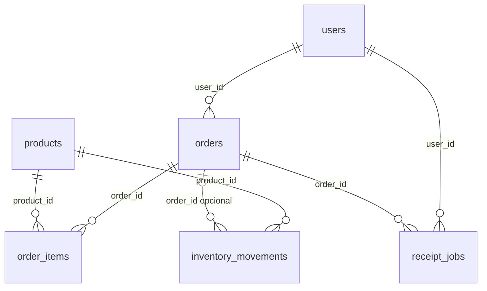

# Estructura de la base de datos

PostgreSQL, base `practice`. La definición ejecutable está en
[`init/01_schema.sql`](init/01_schema.sql) y el seed en
[`init/02_seed.sql`](init/02_seed.sql). Todas las claves primarias son UUID
con valor predeterminado `gen_random_uuid()`. Todas las columnas son `NOT NULL`
salvo las marcadas como opcionales.

## Relaciones

`order_items` resuelve la relación muchos a muchos entre pedidos y productos.
`inventory_movements.order_id` es `NULL` para el saldo inicial y obligatorio
para una venta. `receipt_jobs.user_id` identifica al dueño del trabajo; la API
debe comprobar que también sea dueño del pedido.

## Tablas y columnas

### `users`

| Columna | Tipo | Reglas / significado |
| --- | --- | --- |
| `id` | `uuid` | PK; `gen_random_uuid()` |
| `username` | `varchar(80)` | Único |
| `password_hash` | `text` | Hash bcrypt; nunca devolverlo en la API |
| `role` | `varchar(20)` | `customer` o `admin`; predeterminado `customer` |
| `created_at` | `timestamptz` | Predeterminado `now()` |

### `products`

| Columna | Tipo | Reglas / significado |
| --- | --- | --- |
| `id` | `uuid` | PK; `gen_random_uuid()` |
| `name` | `varchar(120)` | Único |
| `price_cents` | `integer` | Precio actual en centavos; `>= 0` |
| `stock` | `integer` | Saldo actual; puede ser negativo; predeterminado `0` |
| `active` | `boolean` | Predeterminado `true` |
| `created_at` | `timestamptz` | Predeterminado `now()` |

### `orders`

| Columna | Tipo | Reglas / significado |
| --- | --- | --- |
| `id` | `uuid` | PK; `gen_random_uuid()` |
| `user_id` | `uuid` | FK → `users.id` |
| `status` | `varchar(20)` | `confirmed` o `cancelled`; predeterminado `confirmed` |
| `total_cents` | `integer` | Total en centavos; `>= 0` |
| `created_at` | `timestamptz` | Predeterminado `now()` |

Índice de consulta: `(user_id, created_at DESC, id DESC)`.

### `order_items`

| Columna | Tipo | Reglas / significado |
| --- | --- | --- |
| `id` | `uuid` | PK; `gen_random_uuid()` |
| `order_id` | `uuid` | FK → `orders.id` |
| `product_id` | `uuid` | FK → `products.id` |
| `quantity` | `integer` | `> 0` |
| `unit_price_cents` | `integer` | Precio histórico de esa venta; `>= 0` |

La pareja `(order_id, product_id)` es única. Hay índice en `order_id`.

### `inventory_movements`

| Columna | Tipo | Reglas / significado |
| --- | --- | --- |
| `id` | `uuid` | PK; `gen_random_uuid()` |
| `product_id` | `uuid` | FK → `products.id` |
| `order_id` | `uuid`, opcional | FK → `orders.id`; `NULL` para apertura |
| `delta` | `integer` | Cambio de stock; distinto de cero |
| `reason` | `varchar(20)` | `opening` o `sale` |
| `created_at` | `timestamptz` | Predeterminado `now()` |

Una apertura requiere `order_id IS NULL` y `delta > 0`. Una venta requiere
`order_id` y `delta < 0`. Hay índice en `(product_id, created_at DESC)`.
`products.stock` es el saldo actual; esta tabla registra cómo cambió.

### `receipt_jobs`

| Columna | Tipo | Reglas / significado |
| --- | --- | --- |
| `id` | `uuid` | PK; `gen_random_uuid()` |
| `order_id` | `uuid` | FK → `orders.id` |
| `user_id` | `uuid` | FK → `users.id`; dueño del trabajo |
| `status` | `varchar(20)` | `queued`, `running`, `completed` o `failed`; predeterminado `queued` |
| `result` | `jsonb`, opcional | Comprobante generado por el worker |
| `created_at` | `timestamptz` | Predeterminado `now()` |
| `updated_at` | `timestamptz` | Predeterminado `now()`; la API/worker debe actualizarlo |

Hay índice en `(user_id, created_at DESC)`. La base no actualiza
`updated_at` automáticamente después de cada `UPDATE`.

## Datos de prueba

- Usuarios: `ana`, `luis`, `admin`. Contraseña de práctica: `Demo12345!`.
- 6 productos, 4 pedidos, 6 líneas, 12 movimientos y 1 comprobante terminado.
- El primer pedido de `ana` vale 6100 centavos: 2 cafés a 1300 y 1 sándwich
  a 3500. El café cuesta actualmente 1500; el precio anterior permanece en
  `order_items`.
- `db/verify.sql` debe devolver cero filas: compara totales y saldos con sus
  líneas y movimientos.
